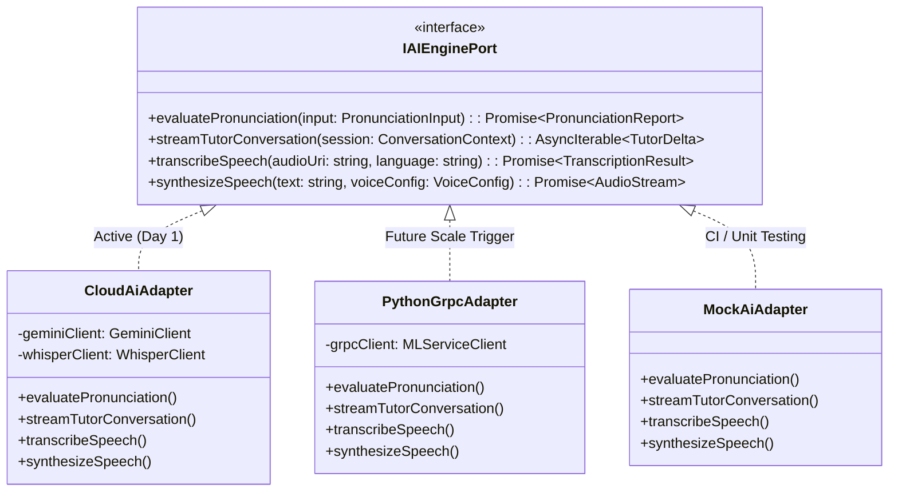
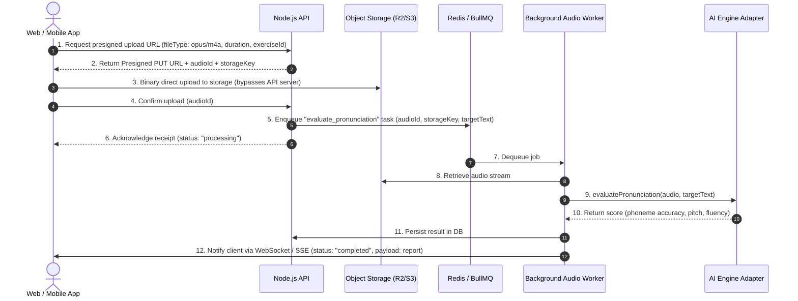
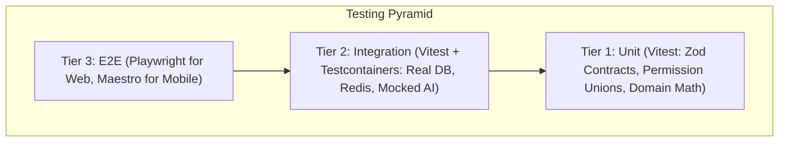

# Architecture Specification: Multi-Language AI & Social Learning Platform

## 1. Executive Summary & Vision

This document details the architectural specification for a multi-language learning platform powered by artificial intelligence and social interactions. The platform delivers cross-platform experiences on **Web (Next.js)** and **Mobile (React Native / Expo)**, backed by a unified **Node.js modular backend**.

### Core Tenets
1. **Developer Experience First:** A single TypeScript monorepo with 100% end-to-end type safety between backend and clients.
2. **Pragmatic Simplicity with Scalability Guarantees:** Start with a Modular Monolith inside Node.js using Hexagonal Architecture (Ports and Adapters) for the AI layer. This avoids distributed microservice overhead on Day 1 while ensuring an extraction path to dedicated Python ML services if needed later.
3. **Audio-Centric Architecture:** Robust asynchronous pipelines for speech evaluation and voice messaging alongside low-latency streaming for live AI conversation tutors.
4. **Cumulative Authorization (PBAC):** A permission-based access control engine allowing users to naturally accumulate multiple roles (e.g., student + teacher + monitor).
5. **Comprehensive Testability:** Multi-tier testing covering unit logic, integration with ephemeral containerized infrastructure, and end-to-end flows on web and mobile.

---

## 2. Monorepo Topology & Workspace Structure

The project uses **Turborepo** with **pnpm** workspaces for fast, cached incremental builds and deterministic dependency resolution.

```
language-learning-platform/
├── apps/
│   ├── web/                    # Next.js 15+ (App Router, Tailwind CSS, shadcn/ui)
│   ├── mobile/                 # React Native / Expo Router (NativeWind v4)
│   └── api/                    # Node.js Modular Monolith (Fastify + tRPC / REST)
├── packages/
│   ├── contracts/              # Shared Zod schemas, API DTOs, audio payload types
│   ├── domain/                 # Core domain logic, cumulative PBAC rules, state machines
│   ├── api-client/             # Shared tRPC client & TanStack Query hooks for web/mobile
│   ├── ai-engine/              # Hexagonal AI port definitions & provider adapters
│   ├── tokens/                 # Design tokens (colors, typography, spacing) shared across Tailwind
│   ├── tsconfig/               # Shared tsconfig bases (react-native, nextjs, node)
│   └── eslint-config/          # Shared linting and formatting rules
├── tooling/
│   ├── docker/                 # Local dev Docker Compose (PostgreSQL, Redis, MinIO)
│   └── test-utils/             # Shared test helpers, mocks, audio fixtures
├── package.json
├── pnpm-workspace.yaml
├── turbo.json
├── ARCHITECTURE.md             # This document
└── NEXT_STEPS.md               # Task tracker & single agent entry point
```

### Dependency Graph & Boundaries
- `apps/web` and `apps/mobile` only import from `packages/*`. They **never** import backend code or direct DB drivers.
- `apps/api` imports `packages/contracts`, `packages/domain`, and `packages/ai-engine`.
- `packages/contracts` has zero external runtime dependencies other than `zod`.
- Strict boundary enforcement via ESLint `import/no-restricted-paths`.

---

## 3. Backend Architecture: Node.js Modular Monolith

### Framework & API Protocol
- **Runtime:** Node.js (TypeScript, ESM).
- **HTTP Server:** **Fastify** for ultra-low overhead, native schema validation support, and high I/O throughput.
- **Client-to-Backend Protocol:** **tRPC (v11)** mounted on Fastify for internal app routes (automatic type inference on both Next.js and React Native without code generation).
- **Binary/Raw Endpoints:** Standard Fastify REST routes dedicated to multipart audio chunk uploads, webhooks, and health probes.

### Hexagonal Architecture for AI (`packages/ai-engine`)



#### The Scalability Guarantee
- **Phase 1 (Active):** `CloudAiAdapter` satisfies `IAIEnginePort` using managed APIs (e.g. Google Gemini 2.5/Flash for reasoning and dialogue, Whisper/Deepgram for phoneme alignment, ElevenLabs/Google Cloud TTS for speech generation). Zero infrastructure management.
- **Future Scale Path:** If custom acoustic modeling (e.g. Kaldi, Wav2Vec2, or Praat pitch tracking) requires Python, a Python FastAPI/gRPC service is created. A `PythonGrpcAdapter` is implemented to satisfy `IAIEnginePort`.
- **Zero Blast Radius:** Swapping the adapter requires **zero changes** to API endpoints, database schemas, or frontend clients.

---

## 4. Audio Pipeline & Real-Time Social Interactions

Audio is a first-class citizen with two distinct processing pipelines based on latency requirements.

### 4.1 Asynchronous Audio Pipeline (Lessons, Pronunciation Drills, Voice Messaging)



#### Audio Specs & Handling
- **Formats:**
  - **Recording:** Opus inside WebM/Ogg (Web via `MediaRecorder`), AAC/M4A or Opus (React Native via `expo-av` / `react-native-audio-recorder-player`).
  - **Storage:** Cloudflare R2 or AWS S3 with standard lifecycles (hot tier for active exercises, cold tier for historical archive).
  - **Playback:** Global CDN with streaming byte-range support.

### 4.2 Synchronous / Real-Time Audio (AI Live Tutor & Social Audio Rooms)
- **Live AI Tutor:** WebSocket connection to backend gateway, proxying bidirectional PCM audio chunks to Gemini Live API / WebSockets.
- **Peer-to-Peer Social Rooms:** WebRTC SFU (LiveKit / Agora) for multi-user voice lounges, conversation exchange tables, and teacher-monitored breakout rooms.

---

## 5. Cumulative Multi-Role Authorization (PBAC)

Users can hold multiple roles simultaneously (e.g. a user can be a `Student` learning Japanese while serving as a `Teacher` for Portuguese and a `Monitor` for community forums).

### 5.1 Permission-Based Architecture

Rather than hardcoding static role checks (`if role === 'teacher'`), the system evaluates fine-grained **Permissions**.

```typescript
// packages/domain/src/auth/permissions.ts

export const Permissions = {
  // Courses & Lessons
  COURSE_CREATE: 'course:create',
  COURSE_EDIT: 'course:edit',
  COURSE_PUBLISH: 'course:publish',
  LESSON_ATTEND: 'lesson:attend',
  
  // Grading & Mentoring
  SUBMISSION_GRADE: 'submission:grade',
  FEEDBACK_RECORD: 'feedback:record',
  STUDENT_MENTOR: 'student:mentor',
  
  // Moderation & Social
  AUDIO_MODERATE: 'audio:moderate',
  USER_MUTE: 'user:mute',
  ROOM_MODERATE: 'room:moderate',
  
  // System Admin
  SYSTEM_ADMIN: 'system:admin',
} as const;

export type Permission = (typeof Permissions)[keyof typeof Permissions];
```

### 5.2 Role Definitions as Permission Sets

```typescript
export const RolePermissionMatrix: Record<RoleName, readonly Permission[]> = {
  admin: Object.values(Permissions),
  course_creator: [
    Permissions.COURSE_CREATE,
    Permissions.COURSE_EDIT,
    Permissions.COURSE_PUBLISH,
    Permissions.LESSON_ATTEND,
  ],
  teacher: [
    Permissions.LESSON_ATTEND,
    Permissions.SUBMISSION_GRADE,
    Permissions.FEEDBACK_RECORD,
    Permissions.STUDENT_MENTOR,
  ],
  monitor: [
    Permissions.LESSON_ATTEND,
    Permissions.AUDIO_MODERATE,
    Permissions.USER_MUTE,
    Permissions.ROOM_MODERATE,
  ],
  student: [
    Permissions.LESSON_ATTEND,
  ],
};
```

### 5.3 Cumulative Permission Computation & Scoping

```typescript
export interface UserRoleAssignment {
  role: RoleName;
  scope?: {
    courseId?: string;
    languageId?: string;
  };
}

export function computeEffectivePermissions(
  assignments: UserRoleAssignment[],
  targetContext?: { courseId?: string; languageId?: string }
): Set<Permission> {
  const effective = new Set<Permission>();

  for (const assignment of assignments) {
    // Check if role is global (no scope) or matches target context
    const isGlobal = !assignment.scope?.courseId && !assignment.scope?.languageId;
    const matchesContext =
      (!assignment.scope?.courseId || assignment.scope.courseId === targetContext?.courseId) &&
      (!assignment.scope?.languageId || assignment.scope.languageId === targetContext?.languageId);

    if (isGlobal || matchesContext) {
      for (const perm of RolePermissionMatrix[assignment.role]) {
        effective.add(perm);
      }
    }
  }

  return effective;
}
```

---

## 6. Data Storage & Persistence Architecture

1. **Primary Relational Store:** **PostgreSQL 16+**
   - Tables: `users`, `user_roles`, `languages`, `courses`, `lessons`, `exercises`, `submissions`, `evaluations`, `social_rooms`, `audio_assets`.
   - Managed via **Prisma** or **Drizzle ORM** (type-safe migrations shared in monorepo).
2. **Queue & Ephemeral Cache:** **Redis 7+**
   - **BullMQ:** Asynchronous audio evaluation queues, transcription retries, email triggers.
   - **Pub/Sub & Presence:** Active user presence in social voice rooms, real-time typing/speaking indicators.
   - **Session & Rate-limiting:** Redis-backed rate limiter for expensive AI endpoints.
3. **Blob Storage:** **Cloudflare R2 / AWS S3**
   - Audio files, user avatars, waveforms, and export archives.

---

## 7. Multi-Tier Testing Strategy



### Tier 1: Unit Tests
- **Framework:** **Vitest** (extremely fast, native ESM, workspace support).
- **Target:** Contract validation, permission calculations, audio helper functions, prompt generation templates.
- **Rule:** Zero network calls, zero database connections, runs in `< 5s`.

### Tier 2: Integration Tests
- **Framework:** **Vitest + Testcontainers**
- **Infrastructure:** Real PostgreSQL and Redis instances spun up in ephemeral Docker containers per test run.
- **Target:** tRPC routers, database queries, BullMQ job processing, upload confirmation lifecycle.
- **AI Port:** Injected with `MockAiAdapter` to verify queuing, score persistence, and notifications without calling live external AI APIs.

### Tier 3: End-to-End (E2E) Tests
- **Web App:** **Playwright**
  - Runs in Chromium with `--use-fake-device-for-media-stream` and fake audio inputs.
  - Tests user signup, audio recording submission, and receiving evaluation reports.
- **Mobile App:** **Maestro**
  - Declarative YAML flows executing against iOS Simulator and Android Emulator.
  - Validates microphone permission prompts, navigation flows, and audio playback.

---

## 8. Non-Functional Requirements & Security

- **Audio File Sanitization:** Verification of magic byte headers on upload confirmation to prevent file spoofing.
- **Secure Presigned URLs:** Max expiration of 15 minutes, bound to exact content-length and content-type restrictions.
- **Rate Limiting:** Granular sliding-window limits on audio generation and AI conversational streaming to protect against runaway API costs.
- **Observability:** OpenTelemetry instrumentation across Fastify, BullMQ, and AI adapters with structured Pino logging.
